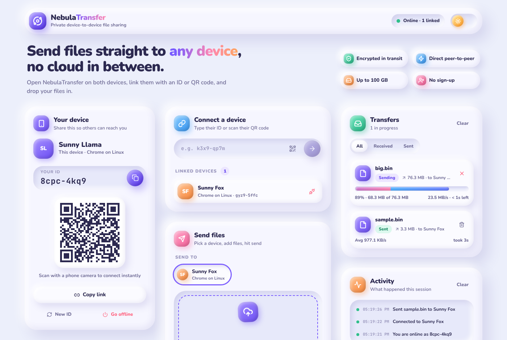
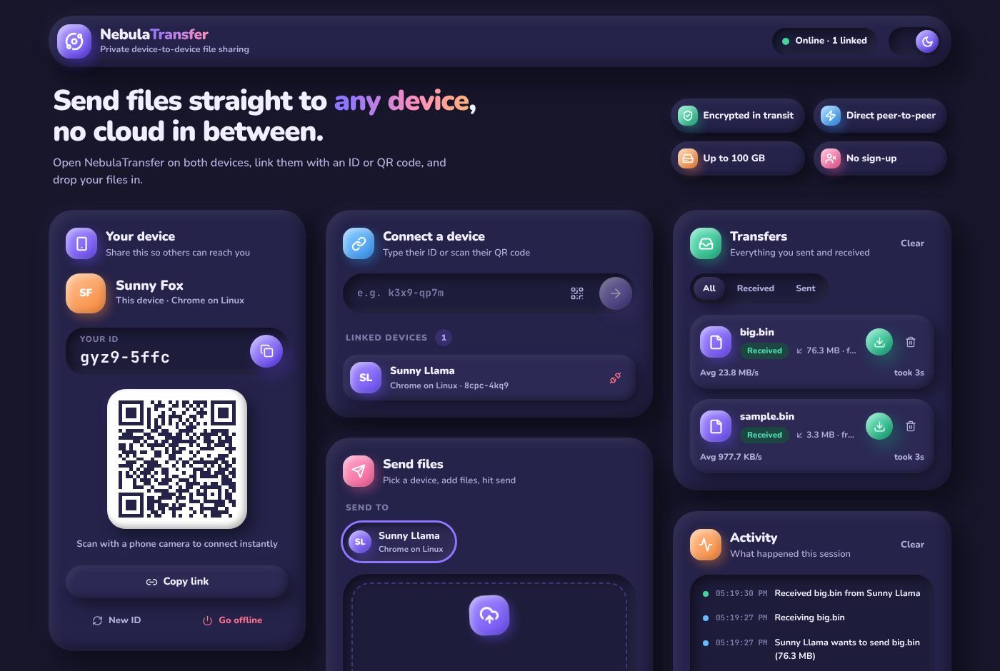

# NebulaTransfer

Send files straight from one browser to another. No uploads, no accounts, no size-limited cloud
bucket in between. Open the app on two devices, link them with a short ID, a link or a QR code, and
drop your files in.

**Live:** [takmashhido.github.io/NebulaTransfer](https://takmashhido.github.io/NebulaTransfer)

| Light | Dark |
|---|---|
|  |  |

## Features

- **Peer-to-peer.** Files travel over a WebRTC data channel, which is encrypted (DTLS) by the browser.
  The PeerJS server is only used to introduce the two devices.
- **Easy linking.** Each device gets a short, readable ID such as `k3x9-qp7m` and a friendly name
  such as *Plucky Owl*. Share the link, show the QR code (phone cameras open it directly), or scan the
  other device's code in the app.
- **Optional PIN.** The receiver must type a 6-digit code that the sender reads out. The PIN never
  leaves the sender's device: the receiver sends what they typed and the sender checks it. After 3
  wrong tries the transfer is cancelled.
- **Big files, many files.** Up to 100 GB per file. Drag and drop, browse or paste several files and
  they are queued and sent one after another.
- **Live progress.** Speed, percentage and time remaining on both ends. Either side can cancel.
- **Low memory use.** Received chunks are stored in IndexedDB as they arrive and only joined
  together when you save the file. Images, video, audio, PDFs and text files can be previewed first.
- **Claymorphism UI.** Soft clay cards, light and dark themes, responsive down to small phones,
  keyboard accessible, and it respects reduced-motion settings.

## Getting started

```bash
npm install
npm run dev        # http://localhost:5173
```

| Script | What it does |
|---|---|
| `npm run dev` | Start the Vite dev server |
| `npm run build` | Type-check and build to `dist/` |
| `npm run preview` | Serve the production build locally |
| `npm test` | Run the unit tests (Vitest) |
| `npm run deploy` | Build and publish `dist/` to GitHub Pages |

To try it alone, open the app in two browser windows (or a normal and a private window) and connect
one to the other's ID.

### Using your own PeerJS server

By default the free PeerJS cloud server is used. To use your own
[PeerServer](https://github.com/peers/peerjs-server), create `.env.local`:

```bash
VITE_PEER_HOST=peer.example.com
VITE_PEER_PORT=443
VITE_PEER_PATH=/
VITE_PEER_SECURE=true
```

## How a transfer works

1. The sender sends an **offer** (name, size, type, number of chunks).
2. The receiver accepts it, typing the PIN if one is required. The sender checks the PIN and sends
   **start**.
3. The file is sent in 256 KB **chunks**, with up to 8 chunks in flight at a time. The receiver
   stores each chunk in IndexedDB and **acks** it.
4. When every chunk is acknowledged the sender sends **done**. The receiver checks it has every
   chunk and replies **done-ack**.

Either side can send **cancel** at any point. If a connection drops, every transfer on it is marked
as failed on both ends.

## Project layout

```
src/
  lib/
    network.ts     PeerJS session, connections and the transfer protocol
    storage.ts     IndexedDB chunk storage
    identity.ts    Short IDs, share links, friendly names
    config.ts      Limits and PeerJS server settings
    format.ts      Bytes, speed and duration formatting
  store/           Zustand store and types
  components/      UI (cards, modals, toasts)
  styles/clay.css  Claymorphism design system
```

## Limits

- Both devices must keep the tab open until the transfer finishes. The app warns you before you
  close a tab mid-transfer.
- The receiver needs enough free browser storage for the file. The app checks before accepting.
- Some strict corporate or mobile networks block direct WebRTC connections. A TURN server would be
  needed for those; you can add one through PeerJS's `config.iceServers` in `src/lib/config.ts`.
